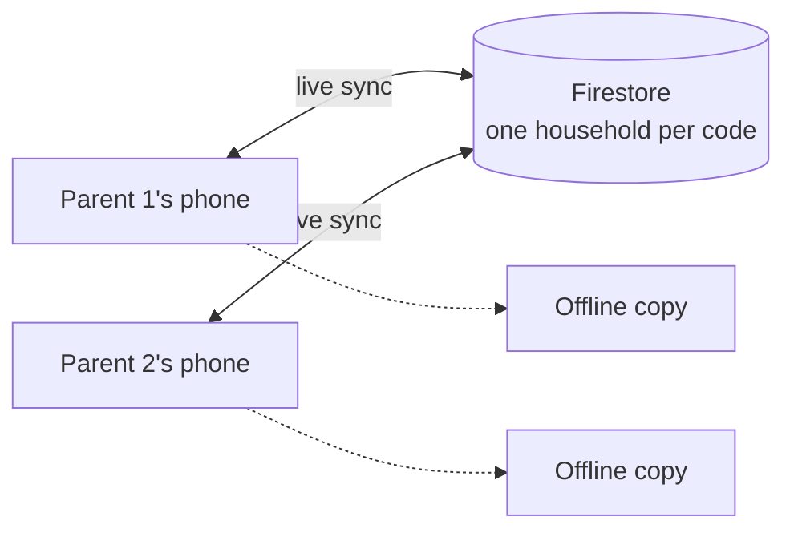

# 🍼 Baby Feed Tracker

**Two phones. One live view. Built for 3am.**

A shared feeding, nappy and milestone log for new parents. Tap once on your phone and the other parent sees it straight away.

**[Open the live app](https://charliesfirstyear.com)**

<!-- Add 2 or 3 phone screenshots side by side here -->

---

## The problem

At 3am you need two answers fast: **when was the last feed, and how much did they take?** The apps I tried were cluttered, wanted an account, or didn't sync between two phones. Notes apps don't share and paper is slow. So I built the one I wanted.

## What it does

| | |
|---|---|
| 🍼 **Feeds** | Start a feed in one tap, add the amount later, or log a past one. Shows time since the last feed, the expected next feed and today's total. |
| 🧷 **Nappies** | Quick log with size and a note. A last-7-days view. |
| 📸 **Milestones** | A calendar with one photo and caption per day. |
| 📈 **Trends** | Longest overnight stretch, usual feed times and milk per day, against an age-based reference. |
| ⏱️ **Bottle timer** | Counts down the 2 hour "good for" window and flags when it's time to bin it. |
| 👪 **Sharing** | Join with a short household code. No accounts, no sign-up. |
| 📴 **Offline** | Installs to the home screen and works with no signal. Entries sync when you're back online. |

## How it fits together

## Product decisions

The interesting part of this project is what I chose to leave out or do differently.

| Decision | Why | What it costs |
|---|---|---|
| **No accounts, just a household code** | Sign-up is the last thing a tired parent wants. | The code is the secret. I later added anonymous sign-in and rules so only registered devices can read a household. |
| **It never says "overdue"** | A late feed isn't a failure. | The app shows an amber "Expected 12m ago" instead of a red warning. |
| **Read less, pay less** | Every document read costs money. | Live view follows the last 28 days. Older feeds load only when you open "All". |
| **Photos stored inside Firestore, not Firebase Storage** | Storage needs a paid plan even to stay within its free quota. | Compressed images only. If quality ever matters, swapping the source is a small change. |
| **Offline first** | Hospital wards and nurseries have bad signal. | Firebase and fonts are bundled with the app, so updates mean replacing those files. |
| **A staging site with a loud "TEST VERSION" bar** | I wanted to try changes on a real phone without touching the live data. | A small deploy script to maintain. |

## Under the hood

Plain JavaScript with no build step. Firebase (Firestore and anonymous auth) for sync, GitHub Pages for hosting, and a service worker for offline. A Capacitor wrapper adds a next-feed reminder on iPhone.

## What's next

- [ ] App Store release (the wrapper is set up)
- [ ] A drawing for each bottle brand
- [ ] A paid tier is sketched but switched off

## Docs

Setup, deployment, the security rollout and the data model live in [docs/SETUP.md](docs/SETUP.md).
