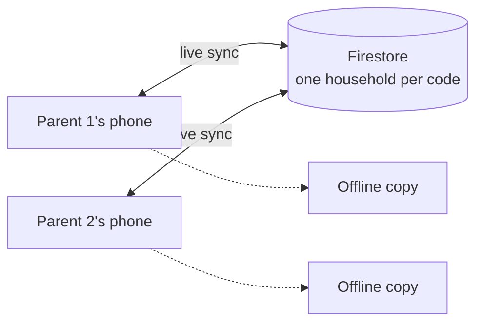

# 🍼 Baby Feed Tracker

**Two phones. One live view. Built for 3am.**

A shared feeding, poo and Moments log for new parents. Tap once on your phone and the other parent sees it straight away.

**[Open the live app](https://charliesfirstyear.com)**

<!-- Add 2 or 3 phone screenshots side by side here -->

---

## About

Little Sips is a calm, one-handed feed tracker for bottle-feeding families. Tap **Start feed** when a feed begins and **Finish feed** when it's done, and it shows how long it has been since the last feed and roughly when the next one is due, on every phone in the household, straight away.

It is deliberately small. There is no account to create, no adverts and no tracking. It works without signal and catches up when you're back online. It never scolds you about a late feed. Everything else, from poos and photos to gentle trends and a first-year progress bar, sits one tap away from the thing you open it for at 3am.

It was built by Lewis Dezso for Charlie's first year, and it is still used and shaped by that household. It is a diary, not medical advice.

## The problem

At 3am you need two answers fast: **when was the last feed, and how much did they take?** The apps I tried were cluttered, wanted an account, or didn't sync between two phones. Notes apps don't share and paper is slow. So I built the one I wanted.

## What it does

| | |
|---|---|
| 🍼 **Feeds** | Start a feed in one tap, add the amount later, or log a past one. Shows time since the last feed, the expected next feed and today's total. |
| 🧷 **Poos** | Quick log with size and a note. A last-7-days view. |
| 📸 **Moments** | A calendar with one photo and a note per day. |
| 📈 **Trends** | Longest overnight stretch, usual feed times, milk per day and daytime gaps, all read from what you log. No targets and no comparison with other babies. |
| ⏱️ **Bottle timer** | Counts down the 2 hour "good for" window and flags when it's time to bin it. |
| 👪 **Sharing** | Join with a short household code. No accounts, no sign-up. Entered the wrong code? Switch it in Settings. |
| 📴 **Offline** | Installs to the home screen and works with no signal. Entries sync when you're back online. |
| ⚙️ **Your way** | ml or oz, light or dark, green, baby blue or rose, and a backup you can download at any time. |

## How it fits together

## Product decisions

The interesting part of this project is what I chose to leave out or do differently.

| Decision | Why | What it costs |
|---|---|---|
| **No accounts, just a household code** | Sign-up is the last thing a tired parent wants. | The code is the secret. Devices now sign in anonymously and register with their household. Rules that only let registered devices read it are written and are being switched on before the App Store launch. |
| **It never says "overdue"** | A late feed isn't a failure. | The app shows an amber "Expected 12m ago" instead of a red warning. |
| **Read less, pay less** | Every document read costs money. | Live view follows the last 28 days. Older feeds, and poos, load only when you open them. |
| **Photos stored inside Firestore, not Firebase Storage** | Storage now needs Google's pay-as-you-go plan, with a card on file, even to stay within its free allowance. | Compressed images only. If quality ever matters, swapping the source is a small change. |
| **Offline first** | Hospital wards and nurseries have bad signal. | Firebase and fonts are bundled with the app, so updates mean replacing those files. |
| **A staging site with a loud "TEST VERSION" bar** | I wanted to try changes on a real phone without touching the live data. | A small deploy script to maintain. |

## Under the hood

Plain JavaScript with no build step. Firebase (Firestore and anonymous auth) for sync, GitHub Pages for hosting, and a service worker for offline. A Capacitor wrapper adds a local next-feed reminder on iPhone, and a GitHub Actions workflow builds it on a cloud Mac and sends it to TestFlight. Both are set up but have not been released yet.

## What's next

- [ ] App Store release (the wrapper and cloud build are set up, awaiting the first run)
- [ ] Security rules switched on for every household
- [ ] A drawing for each bottle brand
- [ ] A paid tier is sketched but switched off

## Docs

Setup, deployment, the security rollout and the data model live in [docs/SETUP.md](docs/SETUP.md). Third-party software and licences are listed in [THIRD-PARTY-NOTICES.md](THIRD-PARTY-NOTICES.md).
